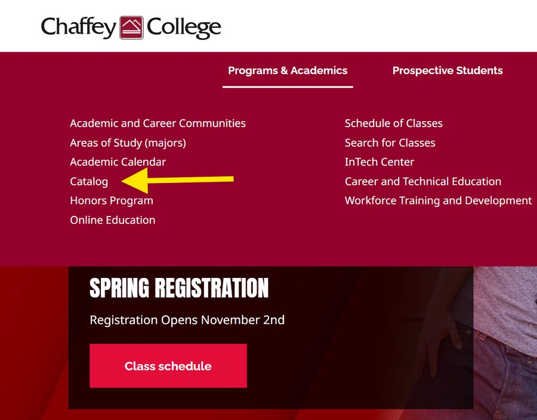
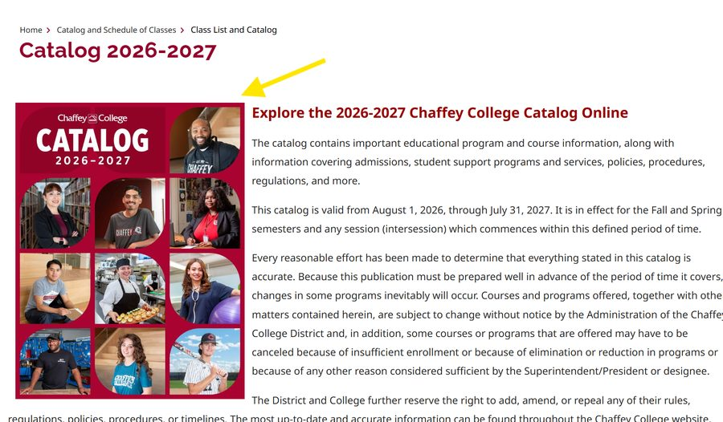
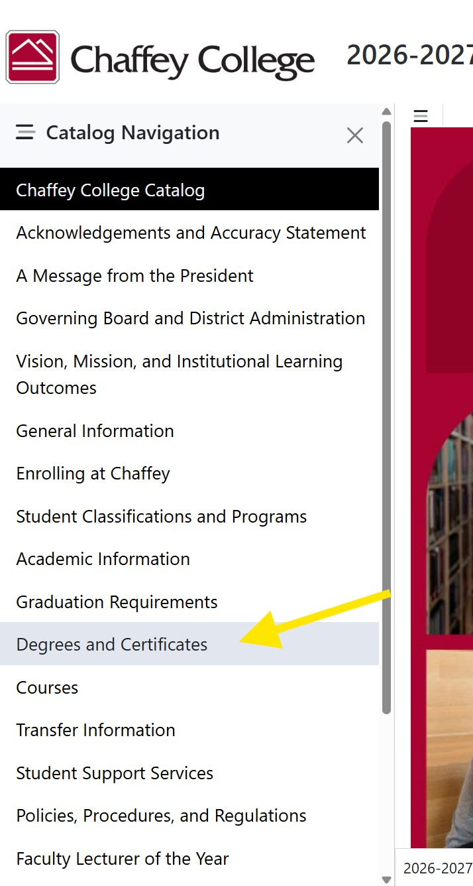
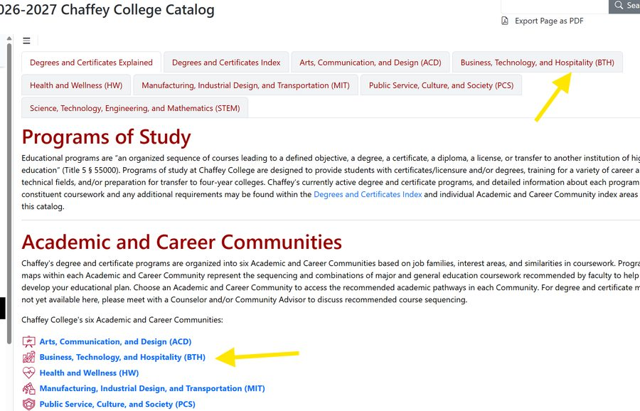
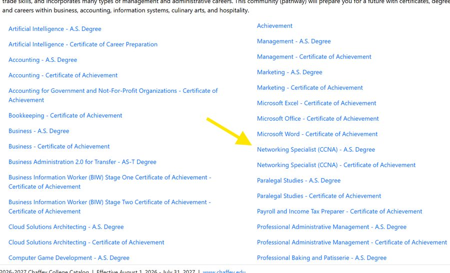
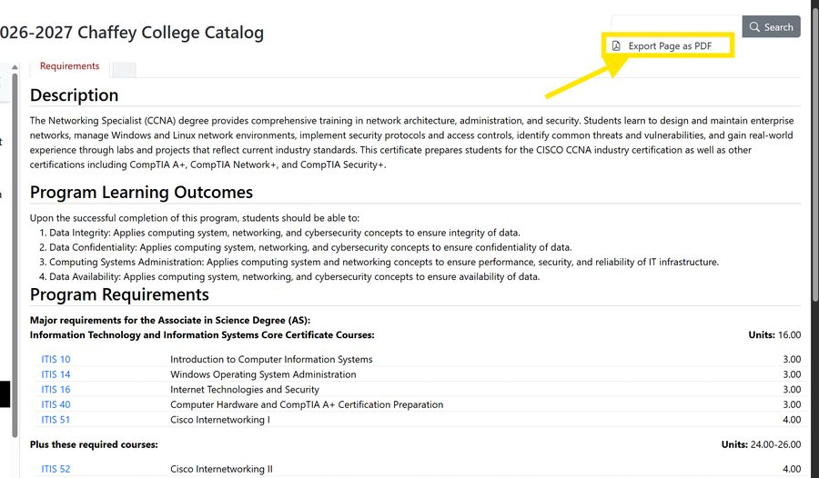
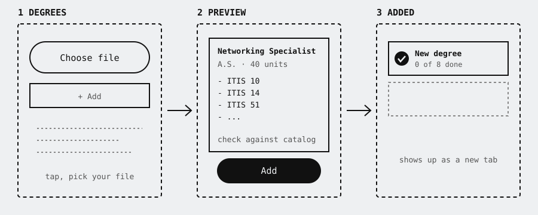
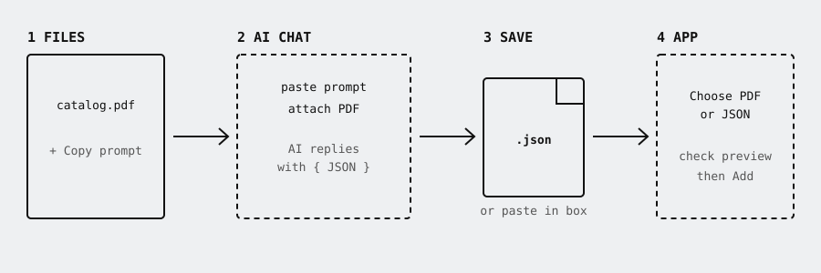

# Degree Checklist

**Free, private, no ads. No accounts, no tracking. Your progress never leaves your device.**

A phone-friendly checklist for college degree requirements. Check off classes once and see how far along every degree is, which classes count toward more than one degree, what is still needed, your XP level and your GPA. It comes with three sample degrees and can load any other degree.

## Use it

Open the app in your phone's browser, then add it to your Home Screen:

- **iPhone / iPad (Safari):** Share button, then Add to Home Screen.
- **Android (Chrome):** the Install app button at the top of the page, or the browser menu.

It opens full screen and works offline after the first visit.

## Add your own degree from the college catalog

These steps use Chaffey College as the example. Other colleges are similar. Look for their online catalog.

**1. Open the catalog.** On the college website, open **Programs & Academics**, then **Catalog**.

**2. Click the catalog.** Choose the current year's online catalog.

**3. Open Degrees and Certificates** in the Catalog Navigation menu.

**4. Find your Academic and Career Community.** Pick the tab or link that matches your field (for example, Business, Technology, and Hospitality).

**5. Find your major.** Click the degree you want, for example Networking Specialist (CCNA), A.S. Degree.

**6. Export the page as a PDF and save it.** Click **Export Page as PDF** at the top right. Save the file somewhere you can find it.

**7. Add it to the app.** Open **Degrees** at the bottom of the app (or the **＋ Add** tab) and choose the PDF. Check the preview against the catalog page, then press **Add**.

**If the preview looks wrong,** use the AI route instead. In the app, press **Copy prompt**, paste it into an AI chat together with your PDF, and save the reply as a `.json` file (or paste it into the box in the app). Then upload that JSON file the same way. AI can make mistakes, so always check the list against your catalog.

To undo a mistake, open the degree and press **Remove this degree**.

## Features

- Check off classes once, see progress across every degree
- Shared-class highlighting, in-progress and registered statuses
- XP and levels, GPA, a character you can pick or upload
- Add your own degree from a catalog PDF, pasted text or a JSON file
- Transfer page: load a transfer agreement (for example from ASSIST) to see which of your classes count toward a bachelor's degree. Locked until you add one
- Backup and Restore your progress as a file

## Backups

Progress is stored in your browser on your own device. Clearing website data, deleting the app or switching phones erases it. Use **Backup** at the top of the page to save a file and **Restore** to load it anywhere. iPhones can clear storage for sites unused for about a week, so add it to the Home Screen and keep a backup.

## Privacy

Your progress, grades, character and added degrees stay in your browser's storage and are never sent anywhere. There is no server and no account. Files you add are read inside your browser and are not uploaded. The app has no ads or analytics.

Two honest notes: GitHub, as the host, can see ordinary web traffic such as visit counts, and the fonts load from Google Fonts. Neither can see anyone's progress.

## Heads up

Always check imported degrees and transfer agreements against the official catalog or ASSIST, and confirm with a counselor. Agreements change every year. Do not type anything private into the app. It does not need it.
